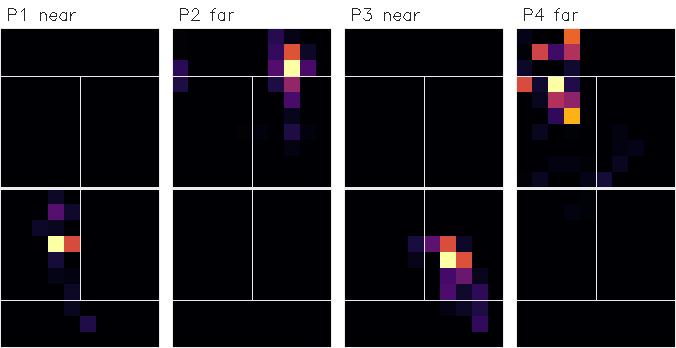
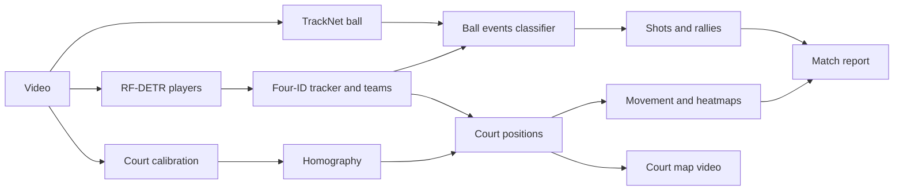

# CourtVision: padel analytics from match video

[](https://github.com/AbdelrahmanAhmed3/courtvision-racket-analytics/actions/workflows/ci.yml)


<sub>Footage: [THE BEST PADEL POINTS OF 2025... so far](https://www.youtube.com/watch?v=gFl3ADnFRtc) by [Daily Padel](https://www.youtube.com/channel/UCpNwqev9uCJkgH517mbOVTw), shown as a short excerpt ([ADR 0006](docs/adr/0006-short-demo-excerpts.md)).</sub>

Drop in a padel match clip and CourtVision finds the four players and the ball, maps
them onto a top-down court, and tells you who hit each shot, how the rallies went, how
far and how fast everyone ran, and where they stood. It runs on a laptop, needs no API
key, and every number it reports has been measured against hand labels, with the
results and their weak spots written up in [`reports/`](reports/).

## What you get from a clip

- **Four players with stable identities and teams.** RF-DETR finds people, a court
  filter keeps the players, and a tracker that never gives out more than four IDs keeps
  each player's ID through the clip.
- **The ball and its events.** TrackNet follows the ball; a small classifier marks
  impacts, bounces and wall rebounds.
- **Shots and rallies.** Each impact becomes a shot with a hitter, a receiver, the
  bounce and an approximate speed; rallies are split from the gaps in play.
- **Movement.** Distance, average and top speed, time at the net, in the middle and at
  the back, and a heatmap per player.
- **A match report** in Markdown and JSON, with a section on how far to trust each
  number. On the clip above:

  > - **Most shots:** Player 3 (near team), 4 shots.
  > - **Most distance:** Player 3 (near team), 16.7 m.
  > - **Top speed:** Player 3 (near team), 11.4 km/h.
  > - **Rally:** 13.9 s long, 12 shots.
  > - In 4 places, the same team hit twice in a row, which the rules do not allow: at
  >   each, a shot was missed, a false one was counted, or the hitter is wrong.

  

- **A Streamlit app** to calibrate the court, run the pipeline, and watch the tracked
  video and the court map side by side with the report underneath.

## Measured results

Measured on 10 hand-labelled rallies from 5 different courts (138 impacts, 651 player
boxes); how the labels were made and scored is in [docs/evaluation.md](docs/evaluation.md).

| What | Result | Details |
| --- | --- | --- |
| Players found (RF-DETR Nano) | precision 1.00, recall 0.97 | [model_comparison.md](reports/model_comparison.md) |
| Player identity | IDF1 0.97, 5 switches (all at crossings); teams 100 % right | [player_identity.md](reports/player_identity.md) |
| Impacts | precision 0.44, recall 0.38 (±2 frames) | [ball_events.md](reports/ball_events.md) |
| Bounces / wall rebounds | recall 0.33 / 0.51 | [ball_events.md](reports/ball_events.md) |
| Hitter of a found impact | right 65 % of the time | [ball_events.md](reports/ball_events.md#shots-and-hitters-2026-10-25) |
| Rallies | 10 of 10 found; start and end within 0.2 s (median) | [ball_events.md](reports/ball_events.md) |
| Distance and speed | no ground truth; checked on synthetic tracks | [player_movement.md](reports/player_movement.md) |

Ball events are the weakest part: the ball tracker was trained on tennis and misses
the padel ball on about 3 frames in 10. Improving them is tracked in
[#52](https://github.com/AbdelrahmanAhmed3/courtvision-racket-analytics/issues/52).

## Quick start

Python 3.10 or newer.

```bash
python3 -m venv .venv
source .venv/bin/activate
pip install -e ".[ui,local,media]"
streamlit run app.py
```

The first run downloads the RF-DETR weights (about 370 MB for Nano, cached in
`~/.roboflow/models`). Generated files go to `outputs/`, which git ignores.

**Ball tracking** needs TrackNet, whose weights are not distributed with CourtVision
(see [Third-party components](#third-party-components)):

```bash
pip install -e ".[tracknet]"
```

Put the TrackNet source in `tracknet-model/TrackNet` and the weights at
`tracknet-model/model_best.pt`; the app finds them there. Without them, you still get
players, teams, movement and the report, without shots or rallies.

**From the command line,** calibrate the court once by clicking named points, then run
the whole pipeline:

```bash
python scripts/calibrate_court.py --input data/raw/clip.mp4 --court-type padel \
  --frame 90 --output configs/calibrations/clip.json
python scripts/run_full_pipeline.py --input data/raw/clip.mp4 \
  --calibration configs/calibrations/clip.json --output-dir outputs/clip \
  --tracknet-dir tracknet-model/TrackNet \
  --tracknet-model-path tracknet-model/model_best.pt --draw-court-map
```

A 15-second clip takes about 2 minutes on an Apple M4. Run
`python scripts/run_full_pipeline.py --help` for every option, including replaying
saved detections without running the detector again.

## Known limitations

- **One camera angle, no cuts.** The clip must come from a single high camera, like a
  broadcast's main view. Cuts to close-ups or replays are not detected, so trim them
  out first. From behind the glass at player height, the four players are all found on
  only 66 % of frames ([model_comparison.md](reports/model_comparison.md)).
- **Ball speed is approximate.** The ball's height is not modelled: speed is measured
  along the court floor from one hit to the next. It is not a radar speed.
- **No point outcomes yet.** CourtVision does not know who won a point, or whether it
  ended in a winner or an error.
- **About 4 in 10 impacts are found,** and fewer than half of the impacts it reports are
  real, so shot counts per player can be off either way. The report says so.
- **Players who cross can swap IDs,** and a false detection near one player can hand
  their ID to their partner ([#47](https://github.com/AbdelrahmanAhmed3/courtvision-racket-analytics/issues/47)).
- **Players who run out of the court are dropped** by the court filter ([#38](https://github.com/AbdelrahmanAhmed3/courtvision-racket-analytics/issues/38)).
- **The court is calibrated by hand.** Automatic calibration from a trained keypoint
  model is planned for v4.1 ([#26](https://github.com/AbdelrahmanAhmed3/courtvision-racket-analytics/issues/26)).
- **Tennis** courts work for calibration and the court map, but the analytics are built
  and measured on padel only.

## How it works



Player feet and the ball are projected onto the court through a homography from four
or more clicked court points, checked with RANSAC. Positions are smoothed before
distances are measured, because far from the camera a pixel of wobble is tens of
centimetres. Ball events come from a logistic regression on 14 features of the ball's
path near each candidate, exported to JSON and run with NumPy. Optical flow can follow
a slowly moving camera (`--track-calibration`). The app also has automatic and
model-assisted calibration modes; they are experiments, with debug views that show why
a proposal failed, and the clicked calibration is the one the results rely on.

## Outputs

| File | What it holds |
| --- | --- |
| `annotated.mp4` | Player IDs, ball trail, and impact, bounce and wall-rebound markers |
| `court_map.mp4`, `court_map_annotated.mp4` | The top-down court on its own, and beside the video |
| `report.md`, `report.json` | The match report; every JSON key is described in [`report.schema.json`](src/courtvision/analytics/report.schema.json) |
| `heatmaps.png`, `heatmaps.json` | Seconds each player spent in each square metre |
| `movement.csv` | Per player: distance, average and top speed, time at the net, in the middle and at the back |
| `teams.csv` | Each player's team, near or far |
| `ball_events.csv` | Impacts with the nearest player, bounces and wall rebounds |
| `shots.csv` | Hitter, receiver, bounce and approximate court speed of each shot |
| `rallies.csv` | Start and end frame, length and shots of each rally |
| `tracks_with_court_coords.csv` | Every player box with image and court coordinates |
| `detections.csv` | Detector output, to replay with `--detections` |

## Decisions and evaluation

- [docs/evaluation.md](docs/evaluation.md): how the clips were labelled, the checks
  that reject bad labels, and how each result is scored.
- [reports/](reports/): each measured result, including the approaches that lost.
- [docs/adr/](docs/adr/): the decisions behind the project, such as
  [padel first](docs/adr/0003-padel-first.md),
  [permissive dependencies only](docs/adr/0002-permissive-licences-only.md) and
  [local player detection](docs/adr/0005-local-player-detection.md).
- [docs/roadmap.md](docs/roadmap.md): v4.1 trains a padel court-keypoint model and a
  padel ball model, and adds shot types; v5.0 is a personal edition for a camera behind
  the glass, with an LLM coaching report.
- [CONTEXT.md](CONTEXT.md): the domain terms (rally, impact, segment, and so on).

## Credits

Match footage is never stored in this repository. The clips used:

| Used for | Video | Channel |
| --- | --- | --- |
| The demo above and the report example | [THE BEST PADEL POINTS OF 2025... so far](https://www.youtube.com/watch?v=gFl3ADnFRtc) | [Daily Padel](https://www.youtube.com/channel/UCpNwqev9uCJkgH517mbOVTw) |
| The hand labels behind every measured result | [Best of Agustín Tapia: Red Bull "out the court" padel points](https://www.youtube.com/watch?v=ZSneXJfDqjI) | Premier Padel |

## Licence

CourtVision is licensed under the [GNU Affero General Public License v3.0](LICENSE); see
also [NOTICE](NOTICE). You may use, study and modify it, but if you distribute it or offer
it as a network service, your whole product must be released under the AGPL too.
Commercial licences without those obligations are available from the author
([ADR 0004](docs/adr/0004-agpl-with-commercial-licence.md)). Contributions need a
contributor licence agreement, so the project can keep offering both licences.

Only permissively licensed components may be bundled or downloaded by default
([ADR 0002](docs/adr/0002-permissive-licences-only.md)).

### Third-party components

Nothing below is bundled in this repository. Each keeps its own licence.

| Component | How it is used | Licence |
| --- | --- | --- |
| Python dependencies (NumPy, OpenCV, SciPy, pandas, and others) | Installed from PyPI | Their own permissive licences |
| [RF-DETR](https://github.com/roboflow/rf-detr) and its COCO weights (Nano, Small, Medium, Base) | Installed with the `local` extra; weights downloaded on first use | Apache-2.0 |
| [yastrebksv/TrackNet](https://github.com/yastrebksv/TrackNet) | Cloned at runtime for ball tracking; weights supplied by the user | **None published** (all rights reserved); to be replaced, see [docs/roadmap.md](docs/roadmap.md) |
| Roboflow hosted models (`tennis-v4d0h/2`, `padel-court-fmfv8/15`, `tennis-court-detection-onesd/10`) | Optional; called through Roboflow's API with your own key | Not verified |

## Repository layout

```text
app.py                    Streamlit app
src/courtvision/          Detection, tracking, geometry, analytics and evaluation
scripts/                  The pipeline, calibration, labelling and scoring tools
evaluation/labels/        Hand labels (no footage)
configs/calibrations/     Saved court calibrations
tests/                    Unit tests, run by CI on Python 3.10–3.12
reports/                  Measured results and experiments
docs/                     Evaluation guide, roadmap, ADRs, README images
```

See [CHANGELOG.md](CHANGELOG.md) for the release history.
